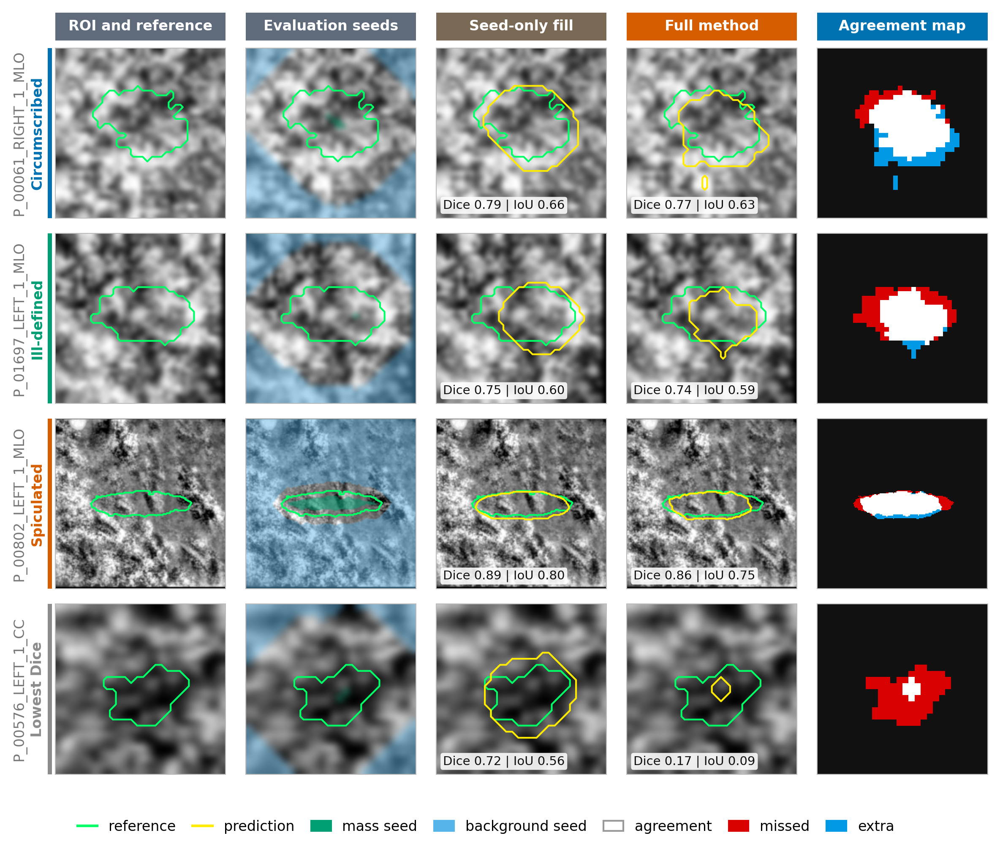

# GrC-Based Image Matting for Mammogram Mass Segmentation

A controlled evaluation of a granular-computing (GrC) image-matting pipeline for mammogram mass segmentation, on **CBIS-DDSM** (main), **MIAS** (secondary) and **DMID** (label probe only). The pipeline is implemented end to end and tested against a seed-only control that uses the same seeds and no image information.

> [!NOTE]
> Base method: Hu, H., Pang, L., Shi, Z. (2016). *Image matting in the perception granular deep learning.* Knowledge-Based Systems, 102, 51–63.

> [!IMPORTANT]
> **Headline finding: the pipeline does not beat the seed-only control.** On the CBIS-DDSM test split the full method scores Dice 0.7511 against 0.8009 for seed-only fill (paired difference −0.0498, 95% CI [−0.0638, −0.0367]). This repository reports that result, the controls behind it, and the diagnostics that probe why. It is an evaluation, not an improvement claim.

📄 [Full Report (PDF)](docs/Project_Report_Updated.pdf)



---

## Table 1 - Datasets and protocol

| | CBIS-DDSM (main) | MIAS (secondary) |
|---|---|---|
| Source | TCIA DICOM, 16-bit crops | Digitised film (Kaggle copy), 1024 × 1024, 8-bit |
| Images used | 1,067 lesion images, 681 lesions, 611 patients | 55 mass images, 53 patients |
| Split | Patient-grouped: train 642, validation 156, test 269 images | Patient-grouped, class-stratified 5-fold CV |
| Classes (CIRC / SPIC / MISC) | 350 / 362 / 355 (test: 89 / 88 / 92) | 22 / 19 / 14 (pooled over held-out folds) |
| Mask type | Algorithm-generated reference masks (initialised from the original DDSM contours) | Filled circle from centre and radius |
| Role | All main experiments | Portability check; circle labels, so Dice is **not comparable** with CBIS-DDSM |

DMID (figshare 24522883; 275 lesions analysed) is used only for the label probe. It is never split, trained on or scored with Dice.

### Architecture (5 layers, shared across both datasets)

```
Layer 1  Multi-scale CLAHE (8×8 + 16×16) + LIPW/LBPW texture encoding at 3×3/5×5/7×7 → six standardised channels
Layer 2  K-means templates from 5×5×6 patches of definite seed pixels + signed cosine template matching
Layer 3  Normalised 7×7 local response pooling → K pooled responses
Layer 4  K pooled responses + local mean intensity (5, 9, 15 px) → RBF-SVM → pixel-wise mass probability P
Layer 5  Hybrid prior α0 = 0.9 P + 0.1 I_norm, then a seed-constrained matting-Laplacian solve → refined α, thresholded at 0.5
```

The crop and the trimap seeds are derived from the reference mask (the reference-assisted setting). The seed-only control and the centre ellipse are evaluation controls, not pipeline layers.

---

### Table 2 - Ablation and controls

**Panel A: CBIS-DDSM test split (269 images)**

| Method | Dice | Sensitivity | Specificity | HD95 (px) |
|---|---|---|---|---|
| Ablation arms (manual 3×3, single 5×5, six-channel no hybrid, intensity only) | 0.7490 – 0.7581 | 0.7708 – 0.7754 | 0.9911 – 0.9917 | 5.0 – 5.1 |
| **Full method** (six-channel + hybrid) | 0.7511 | 0.7722 | 0.9913 | 5.1 |
| **Control: seed-only fill** (same grid / full resolution) | **0.8009** / 0.8063 | 0.9415 / 0.9717 | 0.9883 / 0.9877 | 4.1 / 3.2 |
| Trivial references (trimap filled with 0, with 1, probability map only) | 0.0899 – 0.4527 | 0.2252 – 1.0000 | 0.4231 – 1.0000 | 8.7 – 58.3 |

**Panel B: MIAS, 55 mass images, pooled held-out folds** (circle labels make the seed-only control unusually strong)

| Method | Dice [95% CI] | Sensitivity | Specificity | HD95 (px) |
|---|---|---|---|---|
| Ablation arms (manual 3×3, single 5×5, six-channel no hybrid, intensity only) | 0.9241 – 0.9263 | 0.9399 – 0.9413 | 0.9579 – 0.9589 | 5.9 – 6.0 |
| **Full method** | 0.9248 [0.9092, 0.9380] | 0.9421 | 0.9573 | 5.9 |
| **Control: seed-only fill** | **0.9575** [0.9528, 0.9617] | 0.9970 | 0.9563 | 3.8 |

The seed-only control beats every arm in both panels. The five CBIS-DDSM arms span 0.7490 to 0.7581 (0.009). HD95 is in crop pixels. Ranges group arms that differ by under 0.01 Dice; per-arm values are in the notebook outputs and the report.

**Paired difference, full method minus seed-only fill** (mean per-image Dice, 95% patient-level bootstrap CI, 2,000 resamples): CBIS-DDSM **−0.0498** [−0.0638, −0.0367]; MIAS **−0.0328** [−0.0443, −0.0230]. Differences of about 0.006 between separately trained arms are within refit variation and are not interpreted.

### Table 3 - Per-class Dice

| Class | CBIS-DDSM (n): full / seed-only | MIAS (n): full / seed-only |
|---|---|---|
| CIRC | (89) 0.7346 / 0.7822 | (22) 0.9335 / 0.9584 |
| SPIC | (88) 0.8021 / 0.8552 | (19) 0.9198 / 0.9565 |
| MISC | (92) 0.7182 / 0.7669 | (14) 0.9178 / 0.9575 |
| **All** | (269) 0.7511 / 0.8009 | (55) 0.9248 / 0.9575 |

CBIS-DDSM is the test split; MIAS is pooled over held-out folds. Per-class n is small, so differences between classes are not interpreted. MIAS circle labels are not comparable with CBIS-DDSM reference masks.

### Table 4 - Classifier study (CBIS-DDSM, test split)

Band AUC: ranking of band pixels, pooled, 95% patient-level CI; 0.5 = chance.

| Classifier family (runs) | Validation AUC (inside seeds) | Test band AUC | Test Dice | Dice − control |
|---|---|---|---|---|
| SVM (main; + band rows) | 0.562 – 0.630 | 0.485 – 0.497 | 0.7436 – 0.7451 | −0.0572 to −0.0558 |
| Gradient boosting, MLP | 0.623 – 0.651 | 0.492 – 0.496 | 0.7256 – 0.7343 | −0.0752 to −0.0666 |
| CNN (+ band rows; ROI pixels only) | 0.810 – 0.817 | 0.463 – 0.496 | 0.7411 – 0.7568 | −0.0598 to −0.0440 |

Ranges span the runs in each family; every paired interval for Dice − control lies below 0. The tested classifiers show limited discrimination in the unknown band: pooled band AUC is at or below 0.5 for every run, even where validation AUC inside the seeds is high. This is a result for the classifiers tested, not a claim about every possible texture classifier. On MIAS the band AUC is 0.566 to 0.588 across the four feature arms.

---

## Further Findings

- **Seed information.** Widening the unknown strip (6/10, 12/20, 20/30, 30/45 px) makes every method worse, and the full method stays below seed-only fill throughout: paired gap −0.0498, −0.1195, −0.1626, −0.1723 on CBIS-DDSM. A click-plus-box setting (a different protocol) gives −0.0466 on CBIS-DDSM and −0.0113 on MIAS, where the interval includes 0.
- **Seed-free evaluation.** Without mask-derived seeds, the best method is a centre ellipse alone (Dice 0.5455), which uses no image and no classifier. This is not a detection result: the crop already encodes the lesion's location and size.
- **Granule ceiling.** With perfect granule labels, the ceiling Dice falls from 0.866 (SLIC, 4 px) to 0.434 (16 px). No granule size met the rule declared in advance (+0.05 over seed-only and +0.02 over a plain grid). This rules out this granule design, not granulation in general.
- **Label probe.** On CBIS-DDSM, and on DMID at native resolution, a reference outline is no better aligned with image edges than the same outline shifted by 8 px, so the probe cannot separate loose outlines from boundaries that are simply not sharp edges.
- **Resolution.** The full method stays below seed-only fill at 2,500, 10,000 and 65,536 solve pixels (−0.0498, −0.0348, −0.0328).

---

## Repository Structure

```
GrC-Image_Matting_Eval/
├─ DDSM/
│  ├─ DICOM/
│  │  ├─ Experiments/
│  │  │  ├─ Classifier_study.ipynb
│  │  │  ├─ Config_study.ipynb
│  │  │  ├─ Granule_ceiling.ipynb
│  │  │  ├─ Label_probe.ipynb
│  │  │  ├─ Resolution_sensitivity.ipynb
│  │  │  ├─ Seed_informativeness_swap.ipynb
│  │  │  └─ Seedfree_evaluation.ipynb
│  │  └─ Primary pipeline/
│  │     ├─ Notebook_1.ipynb
│  │     ├─ Notebook_2.ipynb
│  │     ├─ Notebook_3.ipynb
│  │     └─ Notebook_4.ipynb
│  └─ Kaggle_version/
│     ├─ Notebook_1.ipynb
│     ├─ Notebook_2.ipynb
│     ├─ Notebook_3.ipynb
│     └─ Notebook_4.ipynb
├─ docs/
│  └─ Progress_Report.pdf
├─ Journal_figs/
├─ MIAS/
│  ├─ Experiment/
│  │  └─ Seed_informativeness_swap.ipynb
│  ├─ Notebook_1.ipynb
│  └─ Notebook_2.ipynb
├─ .gitignore
├─ Journal_Figures.ipynb
├─ LICENSE
├─ README.md
└─ requirements.txt
```

---

## Key Implementation Notes

- Layer 4 uses an sklearn RBF-SVM (balanced classes, Platt probabilities), trained on definite seed pixels only, never on band pixels.
- Layer 5 solves the constrained system `(L + λD + μI) α = λDt + μα0` on at most 2,500 pixels (λ = 100, μ = 1), with the Laplacian built from the single-channel ROI image. The seed-only control uses the same grid.
- Evaluation seeds: the mask is eroded by up to 6 px (never erased) and the background starts beyond a 10 px dilation.
- CBIS-DDSM's split is grouped by patient, so every view of a lesion stays on one side of the split. MIAS uses patient-grouped, class-stratified 5-fold CV.
- All metrics are computed per image and macro-averaged. Confidence intervals come from a paired patient-level bootstrap (2,000 resamples). HD95 is in crop pixels.
- Fixed settings, chosen on validation data before test results were seen: K = 8, C = 1, γ = auto, threshold α ≥ 0.5.

---

## Setup

```bash
pip install -r requirements.txt
```

Built for Google Colab with Google Drive mounted as persistent storage. Each notebook writes its outputs to Drive and reloads its inputs from Drive at the start, so any single notebook can be rerun standalone once its dependencies exist on Drive.

**Datasets Used:**
- [CBIS-DDSM (TCIA)](https://www.cancerimagingarchive.net/collection/cbis-ddsm/) - DICOM source
- [MIAS Dataset](https://www.kaggle.com/datasets/kmader/mias-mammography)
- [DMID (figshare)](https://figshare.com/) - record 24522883, label probe only

**Run order:**
- **CBIS-DDSM** - `Notebook_1` → `Notebook_2` → `Notebook_3` → `Notebook_4`, then any notebook in `Experiments/` (each reads the saved outputs).
- **MIAS** - `Notebook_1` → `Notebook_2`, then `Experiment/Seed_informativeness_swap`.
- **Figures** - `Output_Figures.ipynb`, after the notebooks above have written their results.

---

## License

MIT License

## Author

- [Sanjib Das](https://github.com/Sanjib-22)
- [Pragyan Thapa](https://github.com/pragyanthapa)